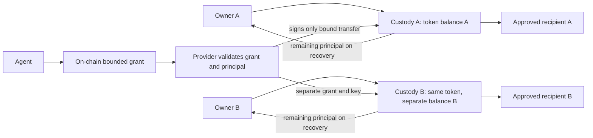

Repository **MultiHopper1/multihopper**, branch **enigma/near-ordinary-grant-provider-20261104**, base `cc45fe067d5a3fbb2d4dc0da31abad75a6f4392d`. Tested revision and results are recorded in [RESULTS.md](RESULTS.md).

# Ordinary-token transfers and grant-bound provider

This stage replaces the prior custom token `fenced_transfer` mechanism with the ordinary NEP-141 `ft_transfer` path, storage-registration queries and `storage_deposit`. It runs compiled WASM and actual synthetic transactions on a disposable local nearcore node. No ordinary live token was contacted. Our synthetic token implements the transfer/registration subset used here; this is not certification of the entire NEP-141/NEP-145 interface, `ft_transfer_call`, every token extension, or mainnet support.

## Custody and provider boundary

Each owner/policy/asset/chain namespace has a distinct custody account with its own randomly generated Ed25519 key. The key-provider child process keeps keys, signed transaction bytes and accounting in a private directory (0700) and SQLite file (0600). The coordinator receives public account IDs and transaction hashes, never private keys or signed payloads. A narrow inherited-stdio interface has no arbitrary-signing, key-export, receiver override, token override or transaction override endpoint. A single active-process lease and serialized requests prevent competing provider instances from using the same journal concurrently.

Before a new payment signature, the provider independently reads the pinned authorization contract and checks the grant, active policy, expiry, exact custody/asset/chain/recipient binding, policy limits and recognized principal. It constructs the only permitted action itself: one `ft_transfer`, exactly one yocto deposit, fixed gas, no memo. No generic coordinator-supplied transaction is signed. Policy and token WASM hashes and the random local chain identity are checked. Setup and storage fees come from synthetic gas funding, separate from token principal.

This is a **software key-provider boundary**, not HSM/MPC enforcement. It is a separate process but runs under the same host user. A hostile same-user process can read its files; host compromise, database rollback, untrusted local RPC and provider administrator compromise are not solved. Keys are research-only and are deleted with the temporary sandbox. Production requires an independently protected key service/HSM/MPC policy, authenticated owner/session flows, durable anti-rollback storage and chain verification. The inherited pipe is a local capability, not a remotely exposed authenticated service.

Owners and agents still use deliberately public fixture identities in the harness. Those keys demonstrate NEAR caller authorization, not production wallet/session integration. The resolver remains a trusted synthetic identity; the provider derives its requested outcome from final transactions, but this does not make the resolver contract an independently verified settlement oracle.

## Custody map

Both balances can live in the same ordinary token contract's ledger, as NEP-141 specifies. They are separate account-owned balance entries with separate keys; there is no common customer deposit wallet or pooled user balance. Our treasury authorization contract holds no payment-token balance. Gas/storage sponsorship is separate from those token balances. Segregation covers customer custody before settlement: once a payment reaches its approved merchant, it becomes that merchant's funds. Multiple settled payments to the same merchant are not represented as separate customers' ongoing custody.

## Recovery without a custom token cancellation function

Token quantities are canonical U128 decimal strings, with BigInt arithmetic throughout the provider. No floating-point conversion or JavaScript safe-integer ceiling applies to token amounts.

The provider saves the exact signed transaction and operation binding durably **before broadcasting**. Restart retries only those bytes/that transaction hash. It never regenerates a fresh nonce for an uncertain operation. A finalized success credits/debits the principal ledger exactly once; a finalized failed transfer credits nothing. Balance snapshots, incoming donations, missing statuses, timeouts and optimistic receipts are not settlement evidence.

Owner-authorized recovery requires on-chain policy revocation. The provider freezes new signing, enumerates that policy's grants and reconciles all signed operations. A grant that never reached signing can be cancelled at the authorization layer. An already-signed operation is potentially in flight: recovery settles/rebroadcasts that exact transaction and refunds only what remains. It **may complete an already-signed payment after revocation**. It does not claim that ordinary tokens support cancelling it. There is a signing-time authorization check, not atomic revocation of a transaction already signed.

A pruned/expired/unknown transaction or unavailable node can leave recovery blocked. This intentionally sacrifices liveness rather than refunding uncertain funds or signing a duplicate. Archival outcome evidence and carefully verified expiry/nonce invalidation are production requirements; neither a timeout nor a greater account nonce is treated as sufficient proof here.

Funding and refunds also have durable immutable operation IDs. Principal derives only from finalized provider-recorded funding minus finalized payments/refunds, independently of coordinator input and observed token balances. Unsolicited transfers can physically enter a public account but cannot enlarge the amount the provider will spend or recover. No shared customer custody account, swap pool or cross-user netting is used. Two users can hold the same token only in different custody accounts.

## Compatibility limits

- Standard transfer and registration arguments are used; no custom token receipt/cancellation query is used.
- Only reviewed synthetic token contracts are allowed. Tokens with fees, rebasing, callbacks, unusual transfer semantics or unknown code are not admitted.
- The fixture omits unrelated/full-standard functionality; an audited ordinary-token adapter remains a separate production task.
- Chain labels still represent namespaces inside one local NEAR chain. No Base/Solana/EVM or Intents settlement is established.
- Public transfer relationships and amounts remain visible. This change improves the tested spending/recovery boundary, not privacy.
- This fixture enumerates policy grants in a view and uses in-memory maps in WASM. Pagination, storage billing and bounded production gas/storage remain required.

## Reproduce

`python3.12 research/hub/run.py near` runs native regressions, the earlier sandbox gate and this ordinary-token/provider sandbox gate. Reviewed runtime files must already exist. Missing or changed dependency/runtime hashes fail closed; no automatic downloads or public-network fallback occur. Runtime execution is loopback-only; Rust builds are offline. See [intake review](INTAKE.md).
